# 🏥 Healthcare Analytics Portfolio
**Vignesh Karuppan** | B.Sc. MLT | KMCH Intern | ADCR Candidate

---
## 👤 About Me
B.Sc. MLT graduate with 1-year clinical internship at **KMCH Coimbatore**.
Currently pursuing **ADCR at CliniLaunch Research Institute (IBM-partnered)**.
Built 9 clinical data + AI projects using SQL Server, Python, Power BI,
Streamlit, and Ollama Llama 3.2.
📧 vigneshkaruppan911@gmail.com | 📍 Coimbatore, Tamil Nadu
---
## 🚀 Projects
### 1. 🤖 ClinicalGenAI — AI Clinical Trial Monitor
**Tools:** Python · Streamlit · Ollama Llama 3.2 (Local LLM)
AI-powered clinical trial monitoring system with 7 pages.
Llama 3.2 runs completely offline — no API cost — full privacy.
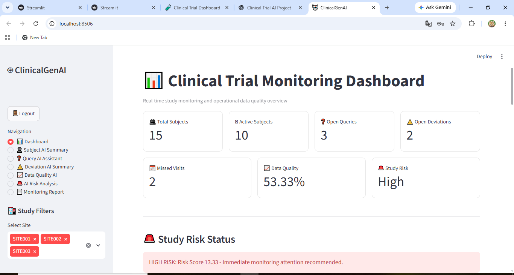
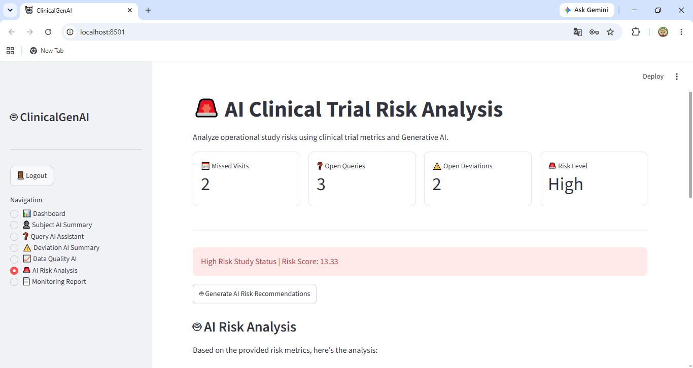
**Features:**
- Live KPI dashboard: 15 subjects, 3 sites, risk scoring
- AI-generated monitoring reports via Llama 3.2
- Automated risk analysis (HIGH/MEDIUM/LOW)
- Data quality assessment + protocol deviation tracking
- Login authentication + site filtering
---
### 2. 🗃️ Clinical LIMS SQL Server Database
**Tools:** SQL Server 2022 · SSMS · T-SQL
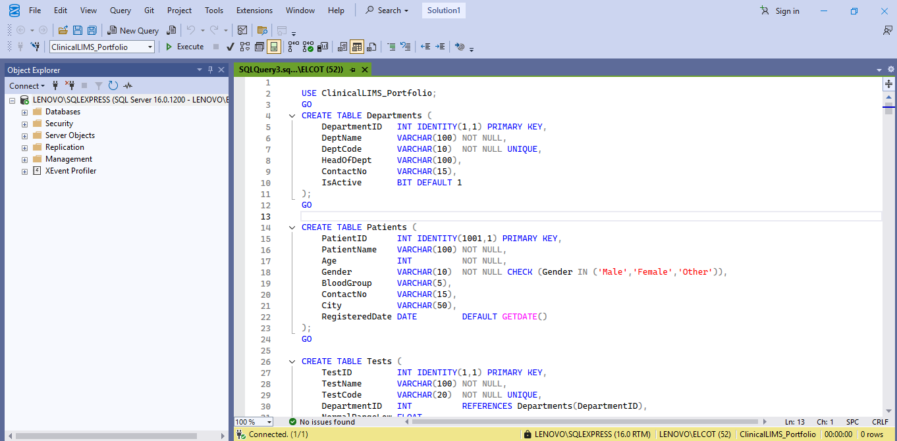
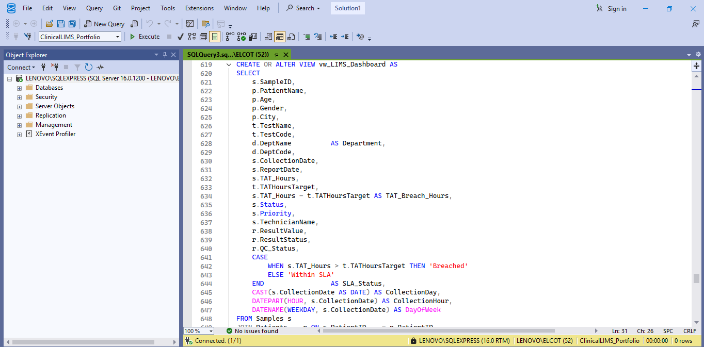
**Features:**
- 6 normalized tables, 8 stored procedures
- Computed TAT column, window functions
- 3 Power BI-ready views
---
### 3. 📊 Power BI LIMS Quality Dashboard
**Tools:** Power BI · DAX · SQL Server (live connection)
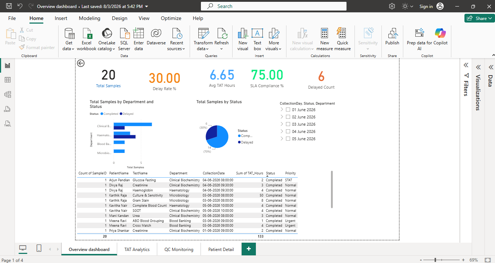
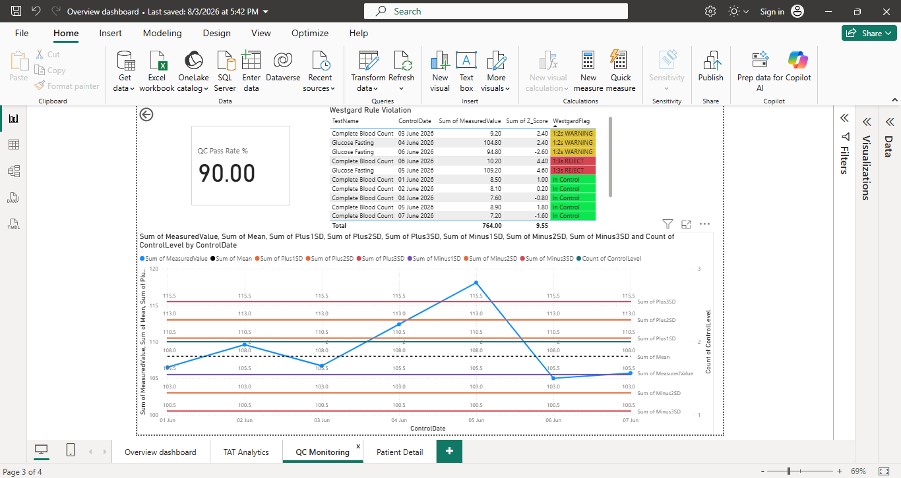
**Features:**
- 4 pages, 6 DAX measures, live SQL connection
- Levey-Jennings QC chart with ±SD lines
- Drill-through to patient detail
---
### 4. 🤖 TAT Delay Predictor
**Tools:** Python · Scikit-learn · Streamlit
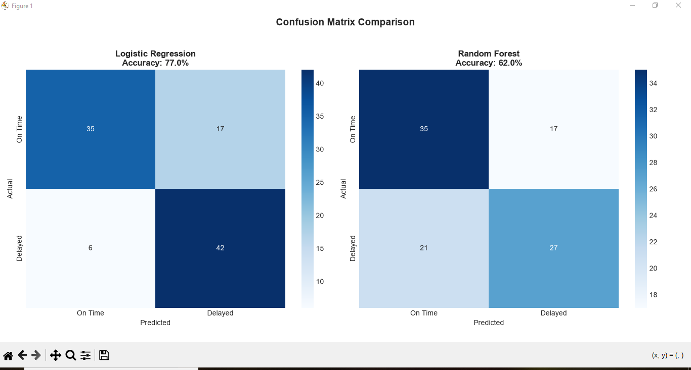
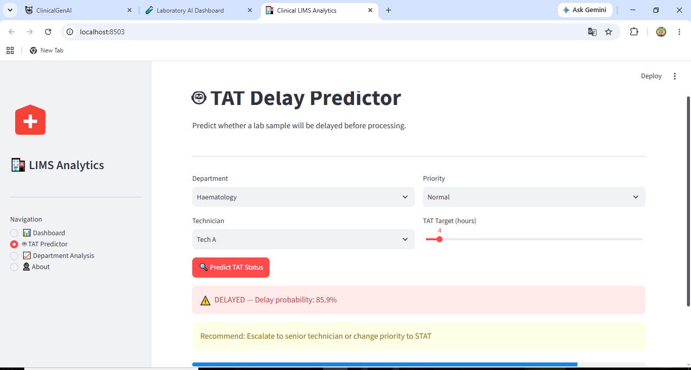
**Features:**
- Random Forest + Logistic Regression
- ROC curve, confusion matrix, feature importance
- 5-fold cross validation
---
### 5. 📈 Levey-Jennings QC System
**Tools:** Python · Matplotlib · Streamlit
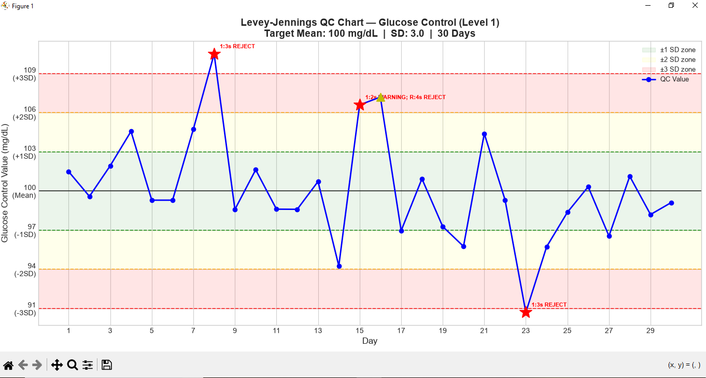
**Features:**
- Complete Westgard rule engine (1:3s, 1:2s, 2:2s, R:4s, 10x)
- Automated violation detection and flagging
---
### 6. 🏥 Hospital Operations Dashboard
**Tools:** SQL Server · Python · Power BI · Streamlit
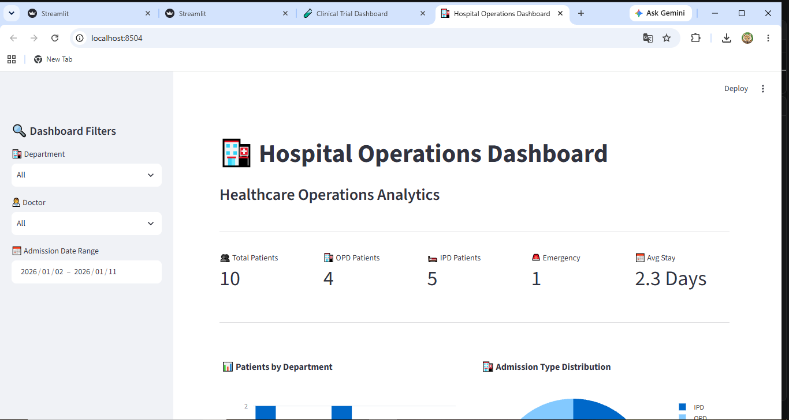
---
### 7. 🔬 Clinical Trial Dashboard
**Tools:** SQL Server · Python · Power BI · Streamlit
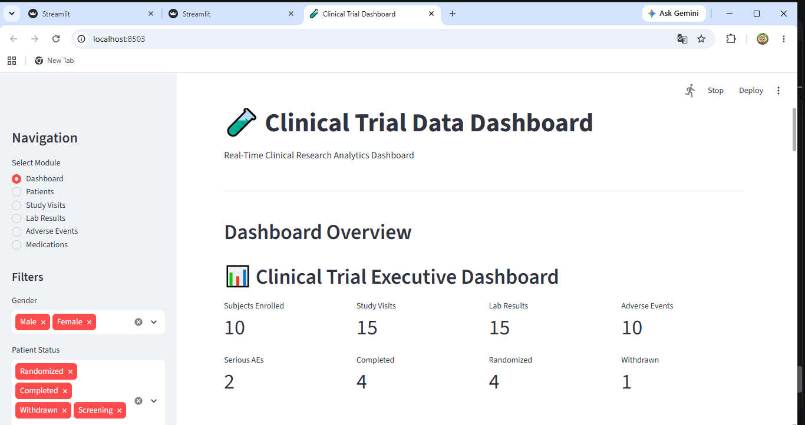
---
### 8. ⚠️ AI SAE Risk + Dropout Model
**Tools:** Python · Scikit-learn · Streamlit
- SAE risk prediction model
- Patient dropout prediction
- Clinical trial safety monitoring
---
### 9. 📋 Clinical Data Management System
**Tools:** SQL Server · Python · Streamlit
- CRF data simulation
- Query management workflow
- Database lock process
---
## 🛠️ Technical Skills
| Category | Tools |
|---|---|
| Database | SQL Server, T-SQL, Stored Procedures, Views |
| Python | Pandas, Numpy, Matplotlib, Scikit-learn |
| AI/LLM | Ollama Llama 3.2, Prompt Engineering |
| Visualization | Power BI, DAX, Streamlit |
| Clinical | GCP, CDM, PV, LIMS, NABL, ALCOA+ |
---
## 🎯 Target Roles
Clinical Data Associate · Patient Safety Associate ·
Healthcare Data Analyst · LIMS Analyst · AI Healthcare Analyst
*Pursuing ADCR at CliniLaunch Research Institute — IBM partnered*
