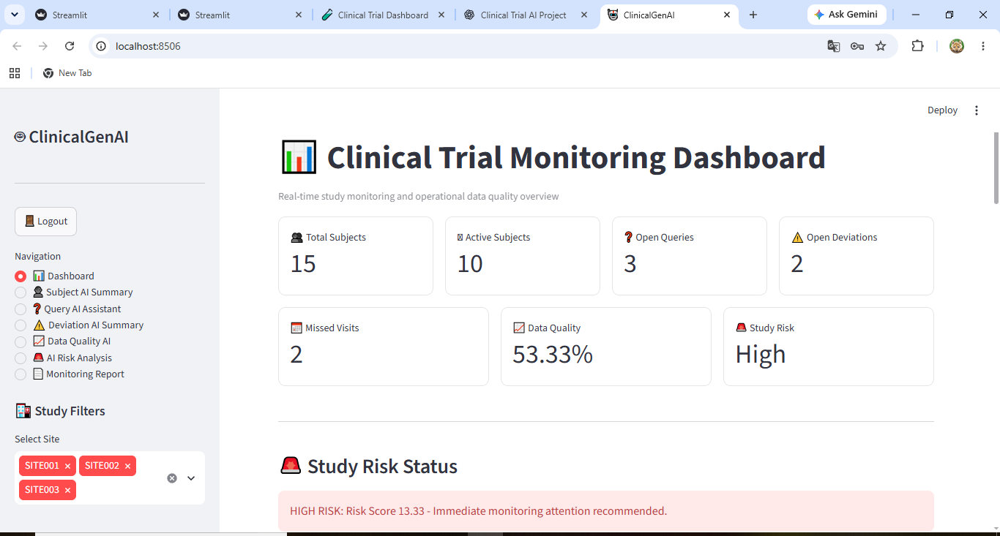
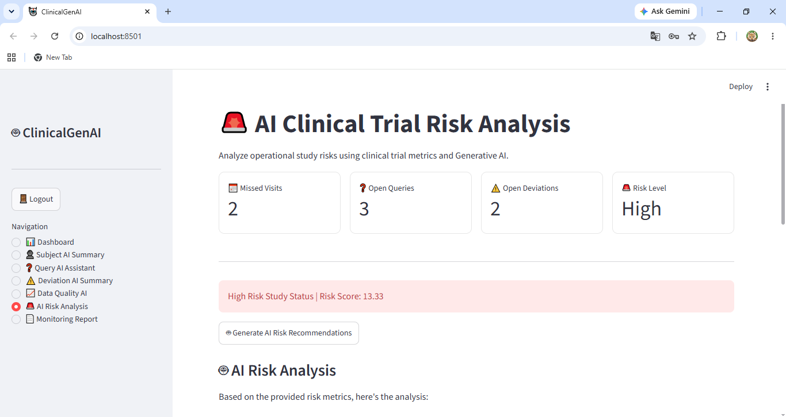
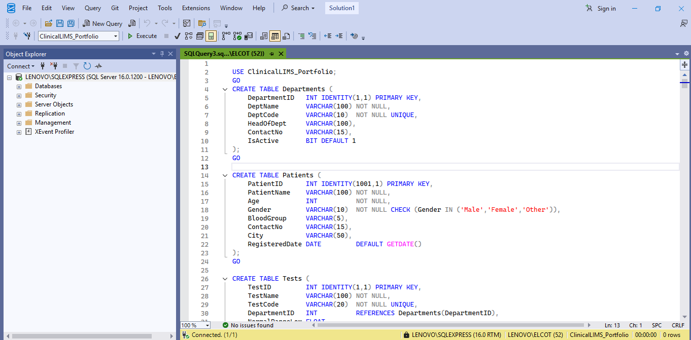
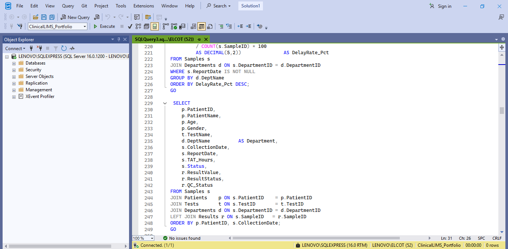
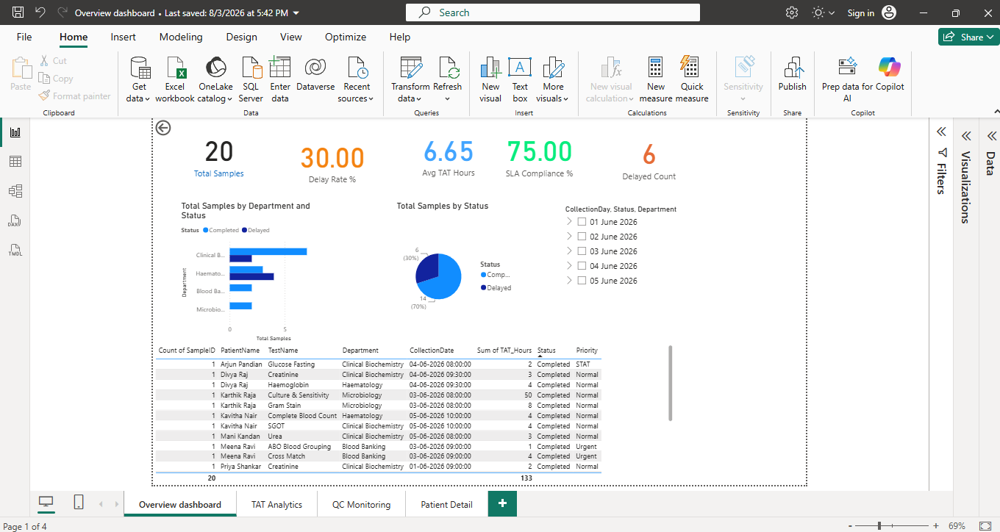
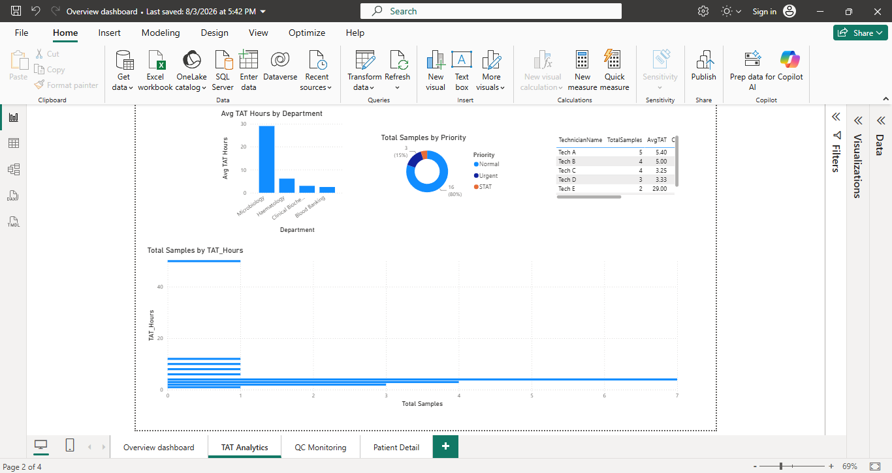
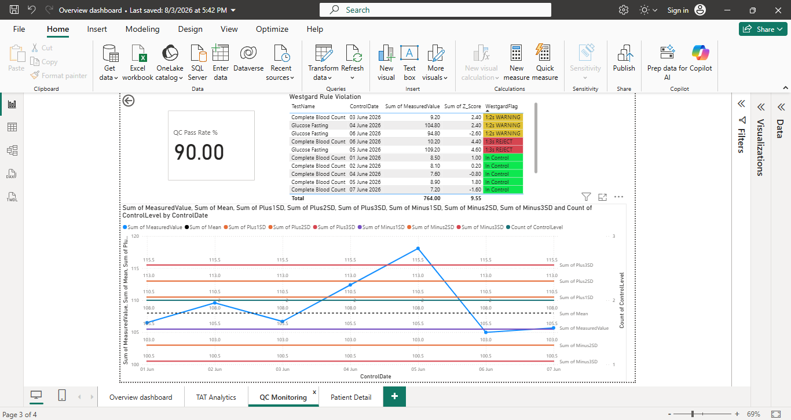
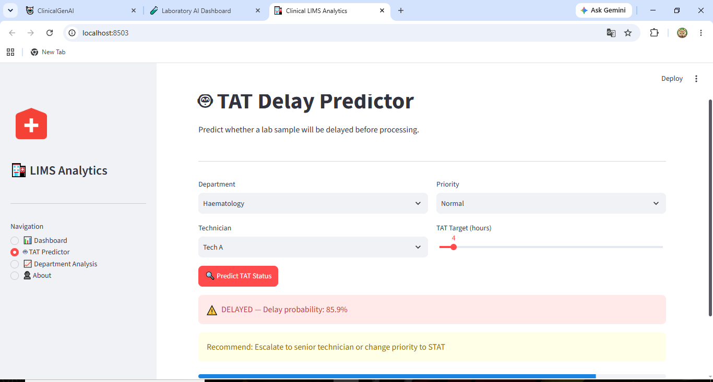
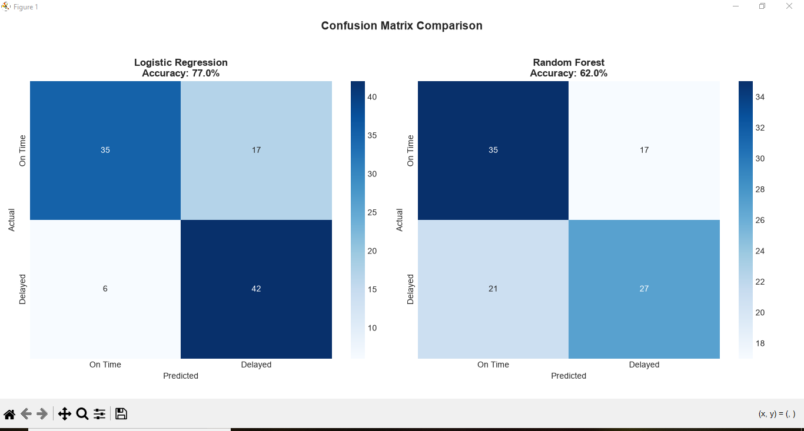

# 🏥 Healthcare Analytics Portfolio

**Vignesh Karuppan** | B.Sc. MLT | KMCH Intern | ADCR Candidate — CliniLaunch Research Institute (IBM-partnered)

[]()
[]()
[]()
[]()
[]()
[]()

---

## 👤 About Me

B.Sc. Medical Laboratory Technology graduate with **1-year clinical internship at KMCH Coimbatore** — one of South India's premier NABL-accredited tertiary care hospitals — across Haematology, Biochemistry, Microbiology, Blood Banking, and Histopathology.

Currently pursuing **Advanced Diploma in Clinical Research (ADCR)** at CliniLaunch Research Institute, Bangalore — IBM-partnered, ISO 9001:2015 certified — targeting Clinical Data Associate and Patient Safety Associate roles at global CROs.

Built **11 clinical data and AI projects** combining healthcare domain knowledge with SQL Server, Python, Power BI, Streamlit, ChromaDB, and Ollama Llama 3.2.

📧 vigneshkaruppan911@gmail.com | 📍 Coimbatore, Tamil Nadu | 🌐 Open to Chennai · Bangalore · UAE · Singapore

---

## 🛠️ Technical Skills

| Category | Tools |
|---|---|
| **Database** | SQL Server 2022, T-SQL, Stored Procedures, Window Functions, Views |
| **Python** | Pandas, NumPy, Matplotlib, Seaborn, Scikit-learn, Streamlit |
| **Vector Database** | ChromaDB, Semantic chunking, Embedding search |
| **AI / LLM** | Ollama Llama 3.2, nomic-embed-text, RAG, Prompt Engineering |
| **Visualization** | Power BI, DAX, Live SQL connection, Levey-Jennings charts |
| **ML Models** | Logistic Regression, Random Forest, AUC-ROC, Cross-validation |
| **Clinical Domain** | GCP, CDM, Pharmacovigilance, LIMS, NABL, ALCOA+, Westgard QC |
| **Tools** | Git, GitHub, VS Code, SSMS, Jupyter Notebook |

---

## 🚀 Projects

---

### 1. 🤖 ClinicalGenAI — AI Clinical Trial Monitoring System with RAG

**Tools:** Python · Streamlit · Ollama Llama 3.2 · ChromaDB · nomic-embed-text

**The most advanced project in this portfolio.**
An AI-powered clinical trial monitoring system with full RAG (Retrieval Augmented Generation) pipeline — running completely offline on a laptop using local LLM and vector database.




#### 🔬 RAG Architecture

```
Documents → nomic-embed-text → ChromaDB Vector Store
                                        ↓
User Query → nomic-embed-text → Similarity Search
                                        ↓
                           Top-k Relevant Chunks
                                        ↓
                    Llama 3.2 (Ollama) + Context Prompt
                                        ↓
                    Grounded Answer + Source Citations
```

#### 📄 Documents Indexed in ChromaDB

| Document | Type | Chunks |
|---|---|---|
| clinical_trial_protocol.txt | Text | knowledge_chunk_0 → chunk_4 |
| clinical_trial_protocol.pdf | PDF (Page citations) | knowledge_chunk_5 → chunk_9 |
| data_management_plan.txt (DEMO-DMP-001) | Text | knowledge_chunk_10 → chunk_23 |
| clinical_data_management_SOP.txt (DEMO-SOP-CDM-001) | Text | knowledge_chunk_0 |
| clinical_trial_monitoring_plan.txt | Text | knowledge_chunk_4 → chunk_5 |

**Total: 24+ semantic chunks across 5 clinical documents**

#### ✨ Key Features

- **Live KPI Dashboard** — 15 subjects, 3 sites (SITE001/002/003), open queries, deviations, risk level
- **AI Monitoring Reports** — Llama 3.2 generates structured clinical monitoring summaries
- **AI Risk Scoring** — HIGH/MEDIUM/LOW with risk score (13.33 = HIGH)
- **Protocol Q&A with RAG** — Ask any question about the trial protocol
- **Source Transparency** — Every answer shows: Document + Location + Chunk ID
- **Anti-Hallucination** — Refuses to answer when information is not in documents
- **Cross-Document Reasoning** — Recognizes when answer is in a different document
- **PDF Page Citation** — Cites exact page number from PDF documents
- **Login Authentication** — st.session_state login system
- **Multi-Site Filtering** — st.multiselect() filters all metrics by site

#### 🛠️ Tech Stack

```python
# Core libraries used
import streamlit as st
import chromadb                          # Vector database
from chromadb.utils import embedding_functions
import requests                          # Ollama API calls

# Embedding model
embedding_fn = embedding_functions.OllamaEmbeddingFunction(
    url="http://localhost:11434/api/embeddings",
    model_name="nomic-embed-text"        # Local embedding model
)

# ChromaDB collection
chroma_client = chromadb.PersistentClient(path="./chroma_db")
collection = chroma_client.get_or_create_collection(
    name="clinical_knowledge",
    embedding_function=embedding_fn
)

# RAG query
results = collection.query(
    query_texts=[user_question],
    n_results=5,
    include=["documents", "metadatas", "distances"]
)

# Llama 3.2 generation
response = requests.post(
    "http://localhost:11434/api/generate",
    json={
        "model": "llama3.2",
        "prompt": f"Context:\n{retrieved_chunks}\n\nQuestion: {user_question}",
        "stream": False
    }
)
```

#### 📸 RAG in Action

The system retrieves relevant protocol chunks and shows full source transparency:

```
Source Documents retrieved for query about "database lock":

Document: data_management_plan.txt
Location: Text document
Chunk: knowledge_chunk_23

  9. DATABASE LOCK Before database lock, required data review,
     query resolution, reconciliation, and approval activities
     should be completed according to the approved study-specific
     procedures.
  10. DOCUMENTATION Data management decisions, corrections,
      and relevant activities should be documented and traceable.
  11. CONFIDENTIALITY Clinical trial data must be handled
      according to applicable privacy requirements.
```

---

### 2. 🗃️ Clinical LIMS SQL Server Database

**Tools:** SQL Server 2022 · SSMS · T-SQL




Fully normalized Laboratory Information Management System database built from scratch — simulating real hospital lab workflows.

**Key Features:**
- 6 tables: Departments, Patients, Tests, Samples, Results, QC_Control
- Computed column for auto TAT calculation: `DATEDIFF(HOUR, CollectionDate, ReportDate)`
- 8 stored procedures including `sp_GetDelayedSamples`, `sp_GetAvgTAT` (OUTPUT parameter), `sp_AddSample` (TRY-CATCH)
- Window functions: `RANK()`, `LAG()`, `AVG() OVER`, Rolling SUM
- 3 Power BI-ready views: `vw_LIMS_Dashboard`, `vw_QC_LeveyJennings`, `vw_Technician_KPI`
- 6 performance indexes, CHECK constraints, 1,600+ lines T-SQL

---

### 3. 📊 Power BI LIMS Quality Dashboard

**Tools:** Power BI Desktop · DAX · SQL Server (Live Connection)





4-page interactive dashboard connected live to SQL Server via Import mode.

**Key Features:**
- 6 custom DAX measures: `Delay Rate%`, `Avg TAT Hours`, `SLA Compliance%`, `QC Pass Rate%`
- Page 1: 5 KPI cards, department bar chart, status pie, data table with conditional formatting, 3 slicers
- Page 2: TAT analytics with target line, technician KPI table, priority donut
- Page 3: Levey-Jennings QC chart with ±1SD, ±2SD, ±3SD DAX-calculated control limits
- Page 4: Drill-through patient detail page

---

### 4. 🤖 TAT Delay Predictor — ML Web Application

**Tools:** Python · Scikit-learn · Streamlit





**Key Features:**
- Random Forest + Logistic Regression classifiers
- Full evaluation: accuracy, AUC-ROC, confusion matrix, feature importance
- 5-fold cross-validation for generalizability
- Streamlit web app with live predictions

---

### 5. 📈 Levey-Jennings QC Chart — Automated Westgard System

**Tools:** Python · Matplotlib · Streamlit

**Key Features:**
- Westgard rule engine: 1:3s (REJECT), 1:2s (WARNING), 2:2s, R:4s, 10x
- Red star markers for violations, yellow triangles for warnings
- Mirrors central laboratory QC in Phase II/III clinical trials

---

### 6. 🏥 Hospital Operations Dashboard

**Tools:** SQL Server · Python · Power BI · Streamlit


Real-time hospital operations monitoring dashboard covering department performance, patient flow, and operational KPIs.

---

### 7. 🔬 Clinical Trial Dashboard

**Tools:** SQL Server · Python · Power BI · Streamlit


Multi-site clinical trial monitoring dashboard with subject enrollment tracking, visit compliance, query aging, and site performance metrics.

---

### 8. ⚠️ AI SAE Risk + Patient Dropout Model

**Tools:** Python · Scikit-learn · Streamlit

Predicts:
- **SAE Risk** — probability a subject will experience a serious adverse event
- **Patient Dropout** — probability a subject will withdraw from the trial

Directly applicable to clinical trial safety monitoring and retention planning.

---

### 9. 📋 Clinical Data Management System

**Tools:** SQL Server · Python · Streamlit

CDM workflow simulation covering:
- CRF data entry and validation
- Query management and resolution
- Database lock process
- CDISC-aligned data structures

---

## 🔬 Clinical Laboratory Background

| Department | Skills |
|---|---|
| Haematology | CBC (3-part & 5-part diff), peripheral smear, ESR, coagulation (PT, APTT) |
| Biochemistry | LFT, KFT, lipid profile, glucose, enzyme assays, dry/wet chemistry analysers |
| Microbiology | Culture & sensitivity, Gram staining, WIDAL, VDRL, blood culture |
| Blood Banking | ABO/Rh typing, cross-matching, DAT, component preparation |
| Histopathology | Tissue processing, H&E staining, cytology, frozen section |
| Quality Management | NABL documentation, GLP/GDP, ALCOA+, Levey-Jennings, Westgard rules |

---

## 🎓 Education & Certifications

| Qualification | Institution | Year |
|---|---|---|
| Advanced Diploma in Clinical Research (ADCR) | CliniLaunch Research Institute, Bangalore (IBM-partnered) | 2026–27 (Pursuing) |
| IBM Technology Certification | IBM (included in ADCR) | 2026–27 |
| B.Sc. Medical Laboratory Technology | Jayamadhi College of Allied Health Sciences, Namakkal (TNDMGRMU) | 2021–2024 |
| Clinical Internship (1 year) | Kovai Medical Center & Hospital (KMCH), Coimbatore | 2024–2025 |

---

## 🎯 Target Roles

**Primary:** Clinical Data Associate · Patient Safety Associate · AI Healthcare Analyst

**Secondary:** LIMS Analyst · Healthcare Data Analyst · Health IT Analyst

**Target Companies:** Parexel · IQVIA · Fortrea · ICON · Accenture Life Sciences · Cognizant Life Sciences

---

## 📬 Contact

📧 vigneshkaruppan911@gmail.com
📱 +91 99621 97417
📍 Coimbatore, Tamil Nadu, India
💼 Open to: Chennai · Bangalore · Hyderabad · UAE · Singapore

---

*"Combining clinical laboratory expertise with AI and data analytics to build the next generation of healthcare intelligence tools."*
